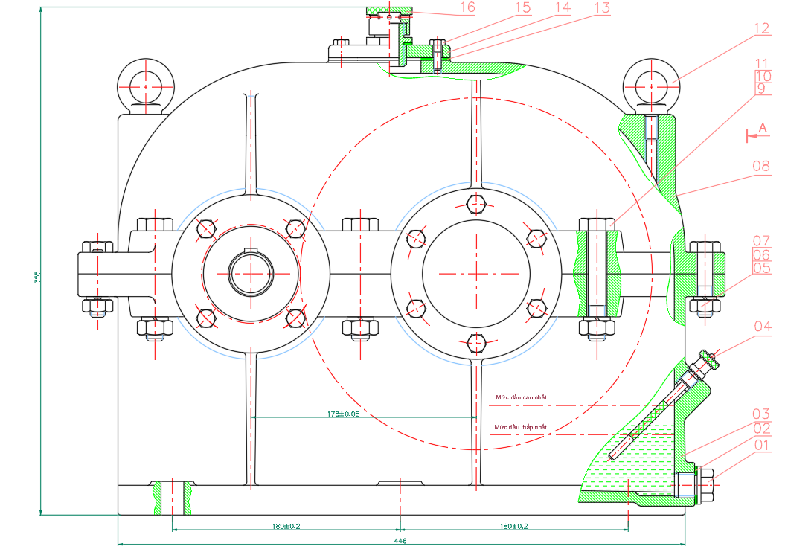
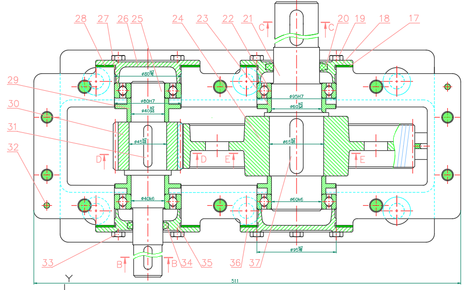
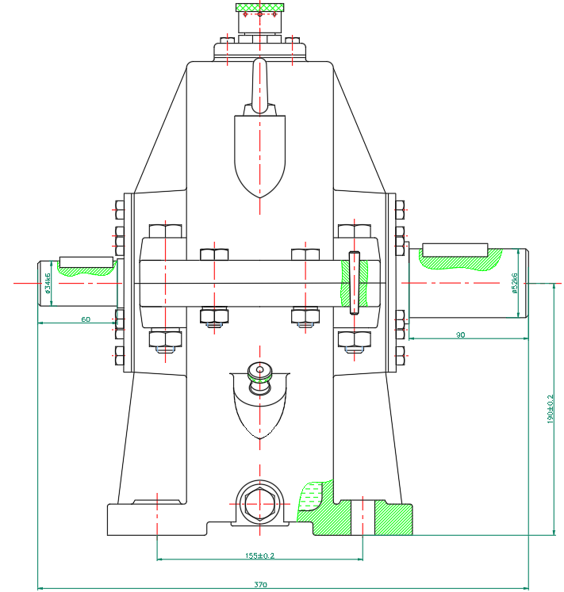

# Mixing Tank Gearbox Design


[](https://www.autodesk.com/products/autocad)
[]()

**SVTH:** Huỳnh Võ Phúc Lộc

**GVHD:** Nguyễn Đức Tôn

---

## Mục lục

1. [Tổng quan](#tổng_quan)
2. [Đề bài thiết kế](#đề-bài-thiết-kế)
3. [Bảng đặc tính kỹ thuật](#bảng-đặc-tính-kỹ-thuật)
4. [Thông số bánh răng dẫn](#thông-số-bánh-răng-dẫn)
5. [Cấu trúc thư mục](#cấu-trúc-thư-mục)
6. [Danh sách bản vẽ](#danh-sách-bản-vẽ)
7. [Phần mềm sử dụng](#phần-mềm-sử-dụng)
8. [Hướng dẫn mở bản vẽ](#hướng-dẫn-mở-bản-vẽ)
9. [Author](#author)

---

## Tổng quan

Đồ án môn học **Truyền động cơ khí** với đề bài **Thiết kế hệ thống thùng trộn**, thực hiện tại Trường Đại học Sư phạm Kỹ thuật TP.HCM, Khoa Cơ khí Chế tạo máy, 

Nội dung đồ án bao gồm tính toán và thiết kế **hộp giảm tốc một cấp bánh trụ răng nghiêng**, dùng để giảm tốc độ và tăng momen xoắn từ động cơ truyền tới trục công tác của thùng trộn. Bộ hồ sơ gồm bản vẽ lắp toàn bộ hộp giảm tốc, bản vẽ chế tạo chi tiết trục dẫn và bánh răng dẫn, cùng file CAD gốc để tham khảo/chỉnh sửa.




## Đề bài thiết kế

| Thông số | Giá trị |
| --- | --- |
| Hệ thống dẫn động | Thùng trộn |
| Loại hộp giảm tốc | Một cấp, bánh trụ răng nghiêng |
| Tỷ số truyền đai (u_đ) | 2.78 |
| Tỷ số truyền hộp giảm tốc (u_br) | 3.55 |
| Số cấp truyền | Bộ truyền đai + Hộp giảm tốc bánh răng trụ răng nghiêng |

---

## Bảng đặc tính kỹ thuật

| Thông số | Động cơ | Trục I | Trục II | Trục III |
| --- | --- | --- | --- | --- |
| Công suất P (kW) | 6.23 | 5.91 | 5.68 | 5.37 |
| Tỷ số truyền u | – | u_đ = 2.78 | u_br = 3.55 | – |
| Số vòng quay n (v/ph) | 715 | 257 | 72 | 72 |
| Momen xoắn T (N.mm) | 83 159 | 219 963 | 749 869 | 734 947 |

---

## Thông số bánh răng dẫn

| Thông số | Ký hiệu | Giá trị |
| --- | --- | --- |
| Modun | m | 2.5 |
| Số răng | Z | 31 |
| Hệ số dịch chỉnh | x | 0 |
| Đường kính vòng chia | d | 78 |
| Góc nghiêng răng | β | 13.83° |
| Cấp chính xác | – | 9 |
| Vật liệu | – | Thép C45, tôi cải thiện HB255 |

---

## Cấu trúc thư mục

```
Mixing Tank Gearbox Design/
├── Images/
├── 12-D6-A0H-BVL.pdf             # Bản vẽ lắp hộp giảm tốc, khổ A0
├── 12-D6-A3H-BANHRANG1.pdf       # Bản vẽ chế tạo bánh răng dẫn, khổ A3
├── 12-D6-A3H-TRUC1.pdf           # Bản vẽ chế tạo trục dẫn, khổ A3
├── 12-D6.dwg                     # File AutoCAD gốc (bản vẽ lắp + bánh răng + trục)
├── README.md                     # File mô tả dự án
└── ___ME(DA.TKM)___.dwt          # Template khung tên A0 -> A4 dùng để vẽ
```

---

## Danh sách bản vẽ

| File | Nội dung | Khổ giấy | Tỉ lệ | Tờ số |
| --- | --- | --- | --- | --- |
| `BanVeLap_A0.pdf` | Bản vẽ lắp hộp giảm tốc một cấp (bánh trụ răng nghiêng) | A0 | 1:1 | 01/01 |
| `ChiTiet_TrucDan_A3.pdf` | Bản vẽ chi tiết trục dẫn (thép C45, HB200) | A3 | 1:1 | 01/02 |
| `ChiTiet_BanhRangDan_A3.pdf` | Bản vẽ chi tiết bánh răng dẫn (thép C45, tôi cải thiện HB255) | A3 | 1:1 | 02/02 |
| `BanVeGoc.dwg` | File AutoCAD gốc chứa cả 3 bản vẽ trên | – | – | – |
| `Template_KhungBanVe.dwt` | Template khung bản vẽ mẫu từ A0 đến A4 | A0–A4 | – | – |

---

## Phần mềm sử dụng

- **AutoCAD 2020 trở lên** – mở file `Template_KhungBanVe.dwt`
- **AutoCAD 2007 trở lên** – mở file `BanVeGoc.dwg`
- Trình đọc PDF bất kỳ để xem các bản vẽ đã xuất

---

## Hướng dẫn mở bản vẽ

### Xem nhanh (không cần AutoCAD)

Mở trực tiếp các file trong `Drawings/PDF/` bằng trình đọc PDF bất kỳ.

### Chỉnh sửa bản vẽ gốc

```
1. Cài đặt AutoCAD (bản 2007 trở lên để mở BanVeGoc.dwg)
2. Mở file Drawings/CAD/BanVeGoc.dwg
3. Các bản vẽ (lắp, bánh răng, trục) nằm trên các Layout riêng biệt
4. Nếu cần vẽ bản vẽ mới đúng chuẩn khung tên của trường,
   mở Drawings/Templates/Template_KhungBanVe.dwt và chọn khổ giấy phù hợp (A0–A4)
```

---

## Yêu cầu kỹ thuật

- Hộp giảm tốc chỉ quay một chiều
- Sơn các bề mặt không gia công
- Chạy rà 2 giờ sau khi lắp để kiểm tra tiếng ồn, nhiệt độ ổ, độ rò rỉ dầu; sau đó thay dầu và xả cặn
- Thay dầu, thay mỡ ổ lăn định kỳ khoảng 1000 giờ làm việc
- Bôi sơn bề mặt lắp ghép và thân hộp để làm kín
- Lỗ chốt định vị nắp hộp và thân hộp được gia công đồng bộ

---

## Author

- **Huynh Vo Phuc Loc**
- GitHub: [Dong-quan](https://github.com/Dong-quan)
